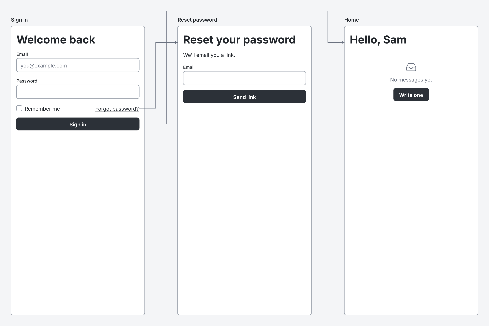

# Wirelith

Wirelith is a small plain-text language for low-fidelity wireframes: screens, layout, forms, tables, states, and click-through flows between screens. You write it in a markdown code fence, and a renderer turns it into a clean SVG or PNG.

> **Status: 0.x, unstable.** The language is at version 0.1 (draft). Nothing is published to a package registry yet, and anything may change before 1.0. [ROADMAP.md](ROADMAP.md) lists what has to happen before then.

## An example

```wirelith
wirelith 0.1

screen "Sign in" phone #signin
  h1 "Welcome back"
  input "Email" type=email placeholder="you@example.com"
  input "Password" type=password
  row justify=between
    checkbox "Remember me"
    link "Forgot password?" -> #reset
  button "Sign in" primary -> #home

screen "Reset password" phone #reset
  h1 "Reset your password"
  text "We'll email you a link."
  input "Email" type=email
  button "Send link" primary

screen "Home" phone #home
  h1 "Hello, Sam"
  empty "No messages yet"
    button "Write one" primary
```



The picture is drawn by the command-line tool from [docs/readme-example.wirelith](docs/readme-example.wirelith). CI draws it again in a container with no network and fails if it differs by a single byte.

## Principles

- **Learnable from one example.** Component names are the ones people guess, and there is one way to write each thing.
- **Independent.** It needs no account, no service and no particular app. Nothing makes a network request.
- **Safe to render.** A source can't load anything, run anything or add markup.
- **Deterministic.** Layout and text measurement are defined in the specification, so independent renderers agree.

## Install

The packages are not published yet, so build them from this repository. You need Node.js 22 or newer and pnpm 11.

```sh
git clone https://github.com/wirelith/wirelith.git
cd wirelith
pnpm install
pnpm run build
```

The Python validator needs Python 3.11 or newer and nothing else. See [ports/python](ports/python).

## Usage

### Command line

```sh
node packages/cli/dist/cli.js render designs.md --format png -o out   # every wirelith fence, one PNG each
node packages/cli/dist/cli.js render signin.wirelith                    # signin.svg next to it
node packages/cli/dist/cli.js check designs.md                          # diagnostics; exit 1 on errors
node packages/cli/dist/cli.js fmt --write signin.wirelith               # canonical form
node packages/cli/dist/cli.js extract out/designs-1.png                 # the source a picture carries
```

Once installed, the command is `wirelith`. See [packages/cli](packages/cli) for every option.

### In code

```js
import { render, validate } from '@wirelith/core';

const { svg, diagnostics } = render(source); // svg is null when the source has errors
```

`@wirelith/core` has no dependencies and works anywhere JavaScript runs. `@wirelith/png` turns its SVG into a PNG. See [packages/core](packages/core) and [packages/png](packages/png).

### For AI agents

`wirelith-mcp` is a local Model Context Protocol server over standard input and output. It offers the whole language on one page, and tools to validate, render and convert sources:

```json
{
  "mcpServers": {
    "wirelith": { "command": "node", "args": ["/path/to/wirelith/packages/mcp/dist/bin.js"] }
  }
}
```

An agent without MCP can read [spec/ai-spec.md](spec/ai-spec.md), or the output of `wirelith prompt`. See [packages/mcp](packages/mcp) and [skills/wirelith](skills/wirelith).

### Python

```sh
PYTHONPATH=ports/python/src python3 -m wirelith diagnostics < signin.wirelith
```

It parses and validates with the same diagnostics as core, and does not render.

## In this repository

| Path | What it is |
| --- | --- |
| [`spec/`](spec) | The language specification, version 0.1 (draft), the one-page version for AI agents, and the font-metrics and icon data |
| [`packages/core`](packages/core) | `@wirelith/core`: parser, validator, layout and SVG renderer |
| [`packages/png`](packages/png) | `@wirelith/png`: PNG output with bundled fonts |
| [`packages/cli`](packages/cli) | `@wirelith/cli`: the `wirelith` command |
| [`packages/mcp`](packages/mcp) | `@wirelith/mcp`: the MCP server |
| [`ports/python`](ports/python) | A parser and validator in pure Python |
| [`conformance/`](conformance) | The conformance suite every implementation can run |
| [`eval/`](eval) | The learnability eval: can a model write valid sources from the one-page spec? |
| [`acceptance/`](acceptance) | The independence test CI runs in a container with no network |
| [`rfcs/`](rfcs) | Proposals to change the language |

Other implementations are listed in [IMPLEMENTATIONS.md](IMPLEMENTATIONS.md), and tools that use Wirelith in [INTEGRATIONS.md](INTEGRATIONS.md).

## Contributing

Read [CONTRIBUTING.md](CONTRIBUTING.md) first. It explains the project's ground rules, sign-off, and how to propose a change to the language. Please also read the [Code of Conduct](CODE_OF_CONDUCT.md). To report a security problem, see [SECURITY.md](SECURITY.md).

## License

MIT. See [LICENSE](LICENSE) and [NOTICE](NOTICE). Anyone may implement the specification, in any language, for any purpose, without permission. For use of the name, see [TRADEMARKS.md](TRADEMARKS.md).
