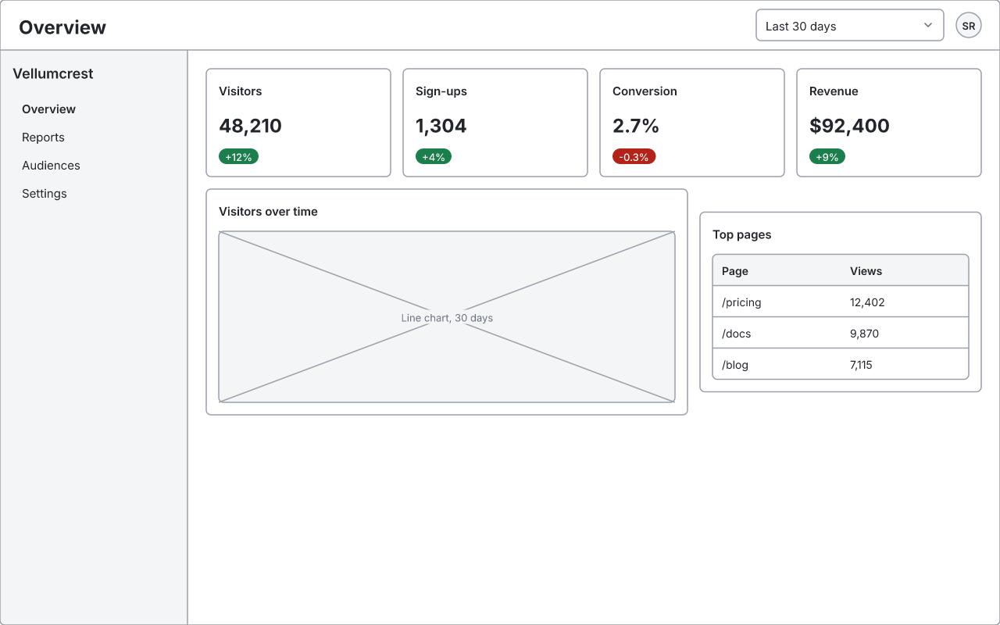
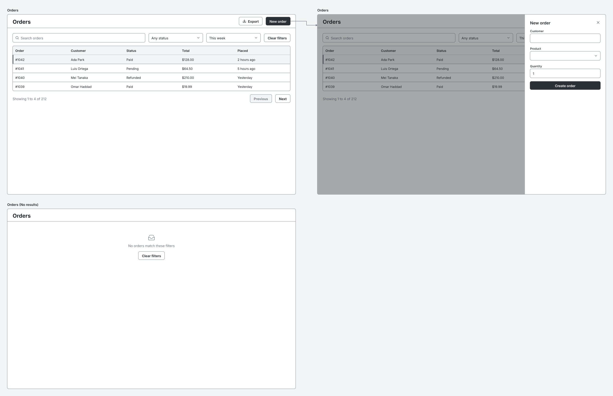
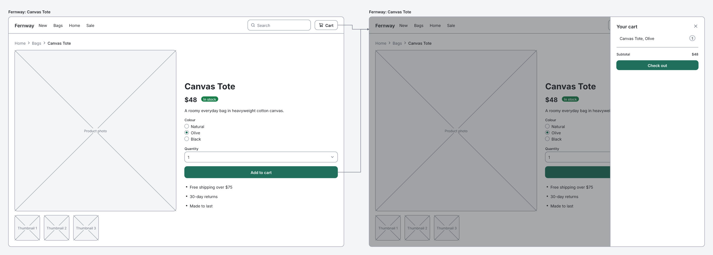
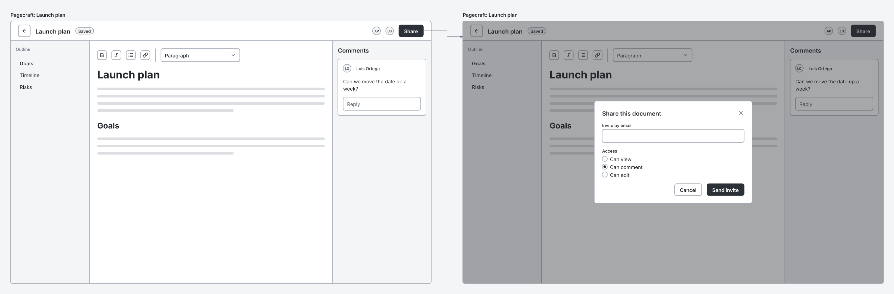
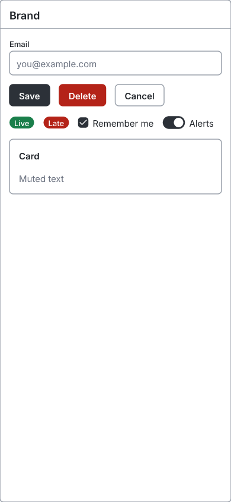
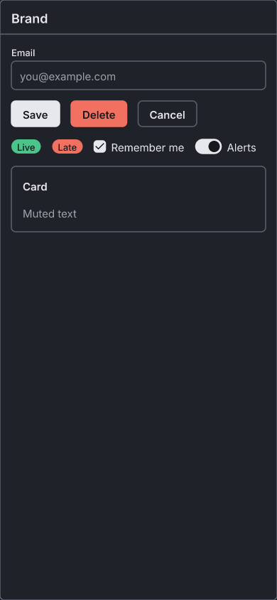
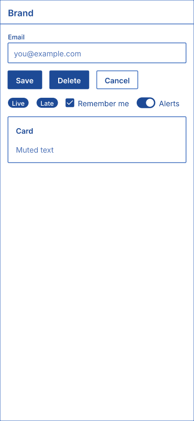
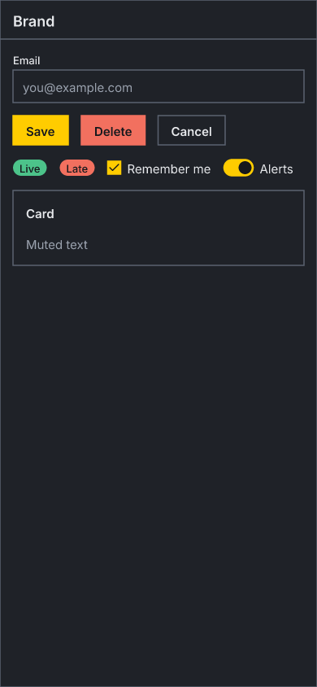
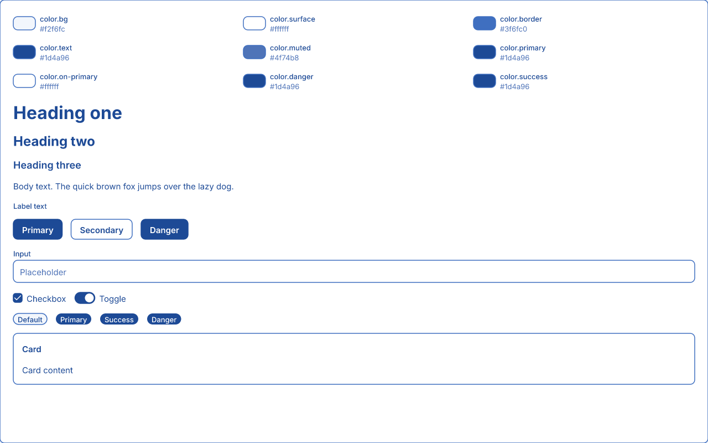

<!-- Generated by scripts/gallery.mjs from the conformance cases. Edit SECTIONS there, not this file. -->

# Examples gallery

Pictures drawn by the reference renderer from sources in the [conformance suite](../conformance), each with its source. They are regenerated from the cases, and CI checks they are up to date.

## Analytics dashboard

A desktop screen with a sidebar, a row of cards, a chart placeholder and a table.



<details>
<summary>Source</summary>

```wirelith
wirelith 0.1

screen "Vellumcrest Analytics" desktop #dashboard
  sidebar
    h3 "Vellumcrest"
    nav [Overview, Reports, Audiences, Settings] active="Overview" vertical
  header
    h2 "Overview"
    spacer
    select [Last 7 days, Last 30 days, This year] value="Last 30 days"
    avatar "Sam Rivera"
  grid cols=4
    card "Visitors"
      h2 "48,210"
      badge "+12%" success
    card "Sign-ups"
      h2 "1,304"
      badge "+4%" success
    card "Conversion"
      h2 "2.7%"
      badge "-0.3%" danger
    card "Revenue"
      h2 "$92,400"
      badge "+9%" success
  row
    card "Visitors over time" grow
      image "Line chart, 30 days" ratio=16:6
    card "Top pages" width=360
      table [Page, Views]
        row [/pricing, "12,402"]
        row [/docs, "9,870"]
        row [/blog, "7,115"]
```

From [`conformance/cases/example-18-1-analytics-dashboard`](../conformance/cases/example-18-1-analytics-dashboard).

</details>

## Data table with filters

A table with search and filters, a variant for "no results", and a drawer that a button opens. Variants are drawn below their screen, and an overlay that a link opens gets its own frame.



<details>
<summary>Source</summary>

```wirelith
wirelith 0.1

screen "Orders" desktop #orders
  header
    h2 "Orders"
    spacer
    button "Export" icon=download
    button "New order" primary -> #new-order
  row
    input placeholder="Search orders" type=search grow
    select [Any status, Paid, Pending, Refunded] value="Any status"
    select [Any date, Today, This week, This month] value="This week"
    button "Clear filters"
  table [Order, Customer, Status, Total, Placed]
    row ["#1042", Ada Park, Paid, "$128.00", 2 hours ago] selected
    row ["#1041", Luis Ortega, Pending, "$64.50", 5 hours ago]
    row ["#1040", Mei Tanaka, Refunded, "$210.00", Yesterday]
    row ["#1039", Omar Haddad, Paid, "$19.99", Yesterday]
  row justify=between
    text "Showing 1 to 4 of 212" muted
    row
      button "Previous" disabled
      button "Next"
  drawer "New order" #new-order
    input "Customer"
    select "Product" [Starter, Team, Enterprise]
    input "Quantity" type=number value="1"
    button "Create order" primary

screen "Orders" #orders-empty of=#orders state="No results"
  header
    h2 "Orders"
  empty "No orders match these filters"
    button "Clear filters"
```

From [`conformance/cases/example-18-4-data-table-with-filters`](../conformance/cases/example-18-4-data-table-with-filters).

</details>

## Product page with a custom theme

A product page whose source defines its own theme, and a cart drawer opened from two places.



<details>
<summary>Source</summary>

```wirelith
wirelith 0.1
theme "fernway" extends=paper
  color.primary #1f6f5c
  radius 10

screen "Fernway: Canvas Tote" desktop #product
  header
    h3 "Fernway"
    nav [New, Bags, Home, Sale]
    spacer
    input placeholder="Search" type=search width=240
    button "Cart" icon=shopping-cart -> #cart
  breadcrumbs [Home, Bags, Canvas Tote]
  row gap=xl
    column width=50%
      image "Product photo" ratio=1:1
      row
        image "Thumbnail 1" width=96 ratio=1:1
        image "Thumbnail 2" width=96 ratio=1:1
        image "Thumbnail 3" width=96 ratio=1:1
    column grow
      h1 "Canvas Tote"
      row
        h2 "$48"
        badge "In stock" success
      text "A roomy everyday bag in heavyweight cotton canvas."
      radio "Colour" [Natural, Olive, Black] value="Olive"
      select "Quantity" [1, 2, 3, 4] value="1"
      button "Add to cart" primary lg -> #cart
      list [Free shipping over $75, 30-day returns, Made to last]
  drawer "Your cart" #cart
    list
      item "Canvas Tote, Olive" badge="1"
    divider
    row justify=between
      label "Subtotal"
      label "$48"
    button "Check out" primary
```

From [`conformance/cases/example-18-5-e-commerce-product-page`](../conformance/cases/example-18-5-e-commerce-product-page).

</details>

## Document editor

A three-column editor with an outline, the document and comments, and a share dialog.



<details>
<summary>Source</summary>

```wirelith
wirelith 0.1

screen "Pagecraft: Launch plan" desktop #editor
  header
    button icon=arrow-left
    h3 "Launch plan"
    badge "Saved"
    spacer
    avatar "Ada Park" sm
    avatar "Luis Ortega" sm
    button "Share" primary -> #share
  sidebar width=240
    label "Outline" muted
    list
      item "Goals" active
      item "Timeline"
      item "Risks"
  sidebar right width=300
    h3 "Comments"
    card
      row
        avatar "Luis Ortega" sm
        label "Luis Ortega"
      text "Can we move the date up a week?"
      input placeholder="Reply"
  row
    button icon=bold sm
    button icon=italic sm
    button icon=list sm
    button icon=link sm
    divider
    select [Paragraph, Heading 1, Heading 2] value="Paragraph"
  h1 "Launch plan"
  text lines=4
  h2 "Goals"
  text lines=3
  modal "Share this document" #share
    input "Invite by email" type=email
    radio "Access" [Can view, Can comment, Can edit] value="Can comment"
    row justify=end
      button "Cancel"
      button "Send invite" primary
```

From [`conformance/cases/example-18-7-document-editor`](../conformance/cases/example-18-7-document-editor).

</details>

## Themes

The same source in three built-in themes, and in a theme the host app supplies.

| paper | ink | blueprint | a host theme |
| --- | --- | --- | --- |
|  |  |  |  |

<details>
<summary>Source (paper)</summary>

```wirelith
theme paper
screen "Theme sample" phone
  header
    h3 "Brand"
  input "Email" placeholder="you@example.com"
  row
    button "Save" primary
    button "Delete" danger
    button "Cancel"
  row
    badge "Live" success
    badge "Late" danger
    checkbox "Remember me" checked
    toggle "Alerts" on
  card "Card"
    text "Muted text" muted
```

From [`conformance/cases/theme-paper`](../conformance/cases/theme-paper).

</details>

<details>
<summary>Source (ink)</summary>

```wirelith
theme ink
screen "Theme sample" phone
  header
    h3 "Brand"
  input "Email" placeholder="you@example.com"
  row
    button "Save" primary
    button "Delete" danger
    button "Cancel"
  row
    badge "Live" success
    badge "Late" danger
    checkbox "Remember me" checked
    toggle "Alerts" on
  card "Card"
    text "Muted text" muted
```

From [`conformance/cases/theme-ink`](../conformance/cases/theme-ink).

</details>

<details>
<summary>Source (blueprint)</summary>

```wirelith
theme blueprint
screen "Theme sample" phone
  header
    h3 "Brand"
  input "Email" placeholder="you@example.com"
  row
    button "Save" primary
    button "Delete" danger
    button "Cancel"
  row
    badge "Live" success
    badge "Late" danger
    checkbox "Remember me" checked
    toggle "Alerts" on
  card "Card"
    text "Muted text" muted
```

From [`conformance/cases/theme-blueprint`](../conformance/cases/theme-blueprint).

</details>

<details>
<summary>Source (a host theme)</summary>

```wirelith
theme brand
screen "Theme sample" phone
  header
    h3 "Brand"
  input "Email" placeholder="you@example.com"
  row
    button "Save" primary
    button "Delete" danger
    button "Cancel"
  row
    badge "Live" success
    badge "Late" danger
    checkbox "Remember me" checked
    toggle "Alerts" on
  card "Card"
    text "Muted text" muted
```

From [`conformance/cases/theme-host`](../conformance/cases/theme-host), drawn with the render options in its `options.json`.

</details>

## A theme of your own

The specimen for a theme defined in the source: every colour token, the type scale and the common components.



<details>
<summary>Source</summary>

```wirelith
wirelith 0.1
theme "cove" extends=blueprint
  radius 8
```

From [`conformance/cases/specimen-block`](../conformance/cases/specimen-block).

</details>
