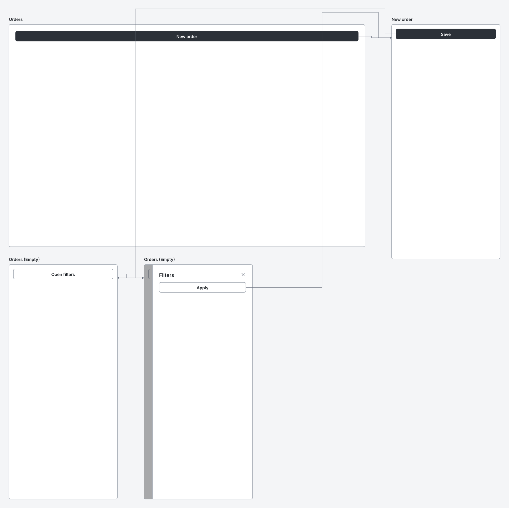
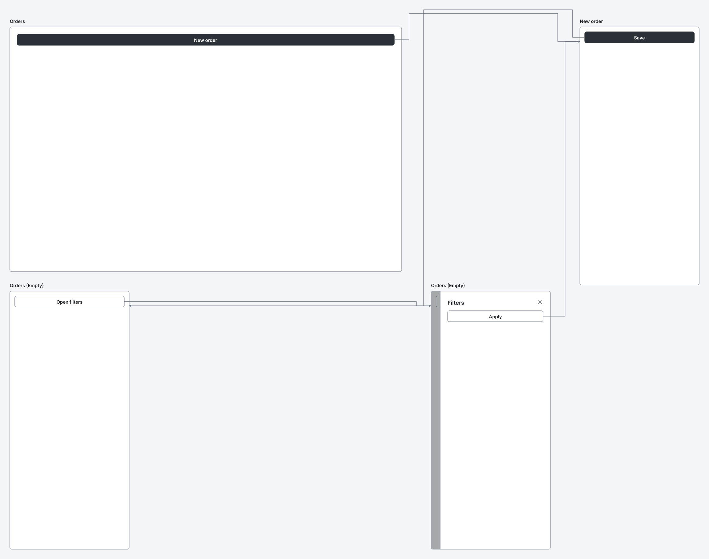

# RFC 0000: Arrows never cross frames

- **Status:** draft
- **Spec version:** 0.1, which is still a draft. Section 14 as written would make this a new minor version. This RFC relies on [RFC 0000-spec-releases](https://github.com/wirelith/wirelith/pull/20) (#20), under which a version is a draft until it is released.

## Summary

Make sure no arrow in the overview runs through a frame. Two rules change:

- **Columns.** A group's frames line up in columns, so the gaps arrows run in are clear for the whole height of a band.
- **The margin.** An arrow to a band above, or more than one band below, travels along the canvas's left margin instead of climbing straight through the bands in between.

Sources don't change.

## Motivation

Section 10.6 routes arrows through the gaps beside frames. It assumes those gaps are clear from the lane above the band down to the frame. Two cases break that assumption.

**1. A group whose rows differ in width.** Each row of a group is laid out on its own, so the gap beside a narrow variant can lie under a wider frame above it. An arrow to the variant, or from it, runs straight through the wider frame. [This source](0000-arrows-avoid-frames/example.wirelith) has a desktop screen with a phone variant, and the variant has a drawer:

```wirelith
screen "Orders" desktop #orders
  button "New order" primary -> #new
screen "Orders" phone #orders-empty of=#orders state="Empty"
  button "Open filters" -> #filters
  drawer "Filters" #filters
    button "Apply" -> #new
screen "New order" phone #new
  button "Save" primary -> #orders-empty
```

Today, two arrows run down through "Orders":



With this change, the drawer frame lines up under the second column, and every arrow stays in a clear gap:



Both pictures were drawn by the `wirelith` command.

**2. An arrow to a band above.** An arrow climbs its own gap to the lane above the target's band. When the target is in an earlier band, that climb goes up through every band in between, at whatever x its gap happens to have. In the conformance case `flow-bands`, the climb misses every frame only because all thirteen screens are desktops, so the gaps of both bands line up. With a phone in the second band, the same arrow runs through a frame in the first.

## Design

**Section 7.4, Groups.** "Frames in a row are 96 px apart. … A group is as wide as its widest row" becomes:

> Rows are 64 px apart. The frames of a group are aligned in columns: the first frame of every row is in the first column, the second in the second, and so on. Each column is as wide as its widest frame, every frame starts at its column's left edge, and columns are 96 px apart. A group is as wide as its columns.

**Section 10.6, rule 3,** begins:

> A gap is the space between two columns of a group, between two groups, or before the first group of a band. It runs the full height of its band, so an arrow in it never crosses a frame. The gap to the right of a frame begins at its column's right edge, not at the frame's.

**Section 10.6, rule 5,** keeps its current route for a target in the same band or the band just below, and adds:

> **A target in a band above, or more than one band below.** The arrow climbs to a lane above its own band (or drops to a lane above the band below it), runs along that lane to the left margin, runs up or down the margin to a lane above the target's band, then along that lane and down the gap beside the target. It takes the first lane, then the second, in that order. The left margin is one gap for the whole canvas, so arrows in it are spread across it like arrows in any gap. Arrows that start or end beside the first group of a band use it too.

**Why this is enough.** An arrow's vertical runs are in gaps, in the left margin, or in the space between bands. Its horizontal runs are in lanes, or level with its source or target frame. With columns, every gap is clear for the whole band, so its vertical runs stay clear. The space between bands and the left margin hold no frames, and the horizontal runs stay clear too. The only frame an arrow may cross is the one it starts in: it leaves from an element inside that frame.

## Learnability

Nothing to learn. Sources are written exactly as before.

## Compatibility

Every valid source stays valid with the same meaning. Two kinds of source render differently:

- **A group with rows of different widths, or with different numbers of frames:** frames after the first column may move right, and the overview may get wider.
- **An arrow to a band above, or more than one band below:** it takes a longer route, and the bands involved get one more lane above them.

Other sources render exactly as before. Among the 100 current conformance cases, only `flow-bands` changes beyond what the notes RFC already changes.

## Security

None. No new output elements or attributes. Arrow routing stays linear in the number of links.

## Alternatives

- **Route around obstacles with a general path search.** It handles any layout, but it's much harder to specify exactly, and independent renderers would struggle to agree on every pixel.
- **Stretch each row to the group's width.** It changes frame sizes, which a source sets on purpose with its device or `size`.
- **The right margin instead of the left.** Bands end at different x, so the right edge isn't one straight strip for the whole canvas.

## Conformance

- **A new case, `flow-variant-columns`:** the source above.
- **`flow-bands` changes:** its arrow back to the first band now takes the margin.
- **New core tests,** each over 340 generated sources with variants, linked overlays, notes, and enough wide screens to wrap into several bands: no arrow crosses a frame other than the one it leaves, and none crosses a notes list (RFC 0000-notes-below-frames).

## Depends on

[RFC 0000-notes-below-frames](0000-notes-below-frames.md) (#13). The implementation builds on it, because the notes list counts as part of its frame's column.
