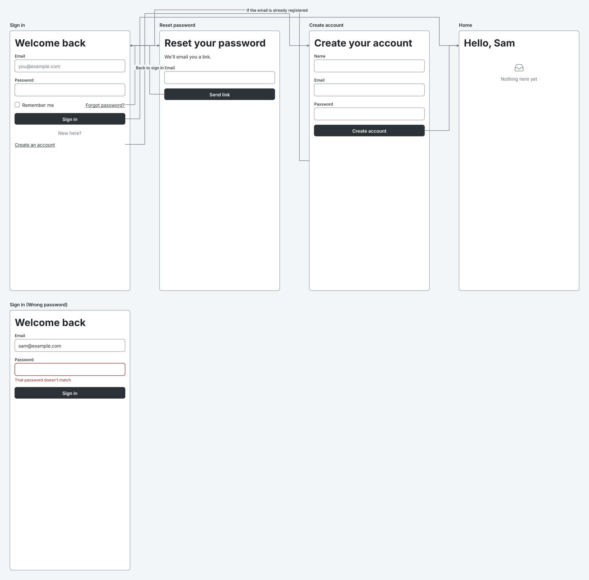
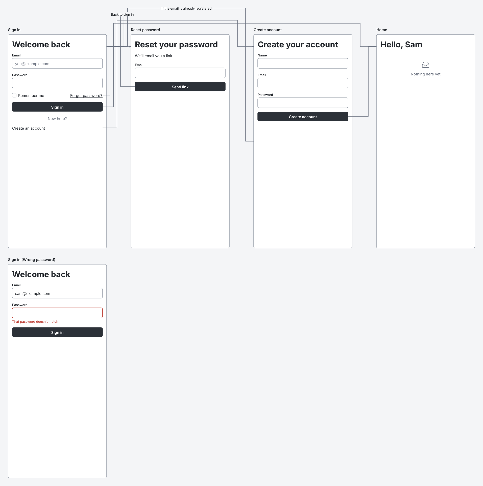

# RFC 0000: Arrow labels on lanes

- **Status:** draft
- **Spec version:** 0.1. The specification is still a draft and no version has been released, so this changes 0.1 rather than starting 0.2.

## Summary

Put every arrow label on a lane above the frames, and draw labels after every arrow line. Then no label covers a frame, a frame title or another label, and no line crosses a label. Sources don't change.

## Motivation

Today a label is centred on the point halfway along its arrow (Appendix C.9). That point is often on the arrow's vertical run in a gap between two frames. Gaps are 96 px wide, and most labels are wider, so the label covers the edges of the frames on both sides. Arrows are also drawn one after another with their labels, so a later arrow's line can cross an earlier label.

This is the example from section 18.2 of the spec, which is also a conformance case. Today, "Back to sign in" covers the "Email" field label inside "Reset password":

With this change, both labels sit on lanes above the frames:

Both pictures were drawn by the `wirelith` command from the case `example-18-2-sign-in-flow`.

## Design

**Section 10.6, rule 5:** an arrow with a label always takes a lane, even when its target is across the gap next to it.

> When the target frame is not across the gap next to the source frame, or the arrow has a label, the arrow climbs or drops down its gap to a lane above the band that holds the target, …

Lane spacing changes, so that a label fits on its lane:

> Each lane is 12 px above the lane below it, or above that band's frame titles for the first lane; a lane that carries a label is 24 px above instead. The space above each band grows by as much.

**Section 10.6, rule 4** applies only to a link without a label.

**Section 10.6, a new rule 7:**

> **Labels.** An arrow's label sits on the lane above the target's band, centred on the arrow's run along it. A label that would reach past the left or right edge of the canvas moves inward until it doesn't. A label never covers a frame, a frame title or another label.

**Section 12.2, element order:** "arrows after those" becomes "arrows after those, and arrow labels after every arrow".

**Appendix C.9, Arrow label:** a `g` with `class="wl-arrow-label"`, drawn after every arrow, centred where section 10.6 places it. The `rect` and text don't change.

**Section 7.4, rule 4:** "with its label at the midpoint" becomes "its label, if it has one, sits on a lane above the frames".

**Why this is enough.**

- **No frames or titles.** A lane is above its band's frame titles, and only lanes are there. The first lane that carries a label is 24 px above the titles. Its 18 px box therefore ends 15 px above the top of the title line.
- **No other label.** Lanes that carry labels are at least 24 px apart, more than a label's 18 px height.
- **No line on top.** Labels are drawn after every line.

## Learnability

Nothing to learn. Sources are written exactly as before.

## Compatibility

Every valid source stays valid with the same meaning. Sources with labelled arrows render differently:

- A labelled arrow between neighbouring frames now rises to a lane and comes back down, instead of crossing the gap directly.
- Bands with labelled arrows get more space above them: 24 px per label.
- A label is a separate `g` after all arrows, instead of inside its arrow's `g`. Hosts that read labels from the SVG need to update.

Among the 100 current conformance cases, three change: `component-overlays`, `example-18-2-sign-in-flow` and `flow-screens-and-variants`.

## Security

None. One new class name on a `g`. No new elements, attributes or limits.

## Alternatives

- **Widen a gap to fit the labels in it.** Labels between neighbours would stay beside their arrows, which reads well. But the width of each gap would then depend on how arrows are routed, and routing depends on where frames are. A renderer would have to iterate to agree on positions, and the canvas could no longer wrap into bands predictably.
- **Wrap or truncate labels to fit the gap.** With several arrows in one gap, each gets only a few pixels, so a wrapped or truncated label would be unreadable.
- **Put labels on the lane only when they don't fit in the gap.** It's two rules instead of one. Deciding what fits depends on how many arrows share a gap, which changes as arrows move to lanes.

## Conformance

- **Three cases change,** as listed above. No new case is needed, because those three cover a label between neighbours, a label on a flow, and labels next to variants.
- **A new core test,** over 340 generated sources, checks that:
  - no label covers a frame, a frame title or another label;
  - every label stays on the canvas;
  - every label comes after the last arrow line.

## Depends on

[RFC 0000-arrows-avoid-frames](0000-arrows-avoid-frames.md). The implementation builds on it, because labels on the margin route sit on the lane above the target's band.
