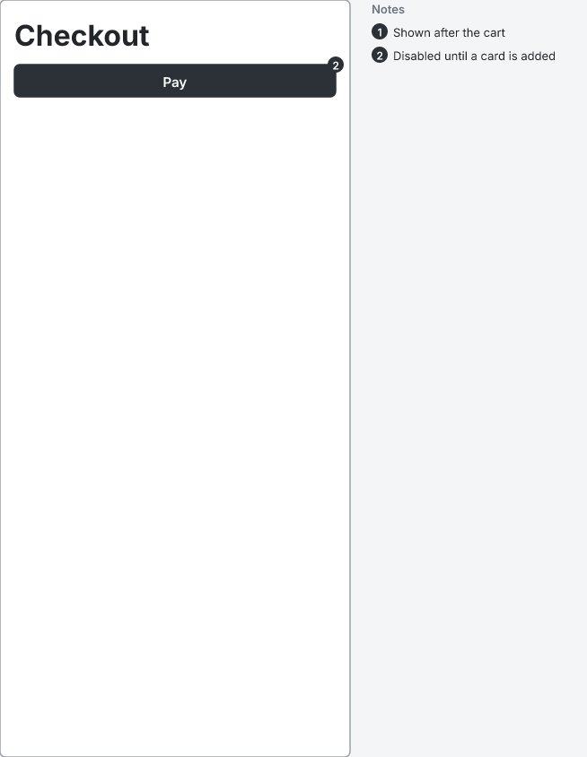
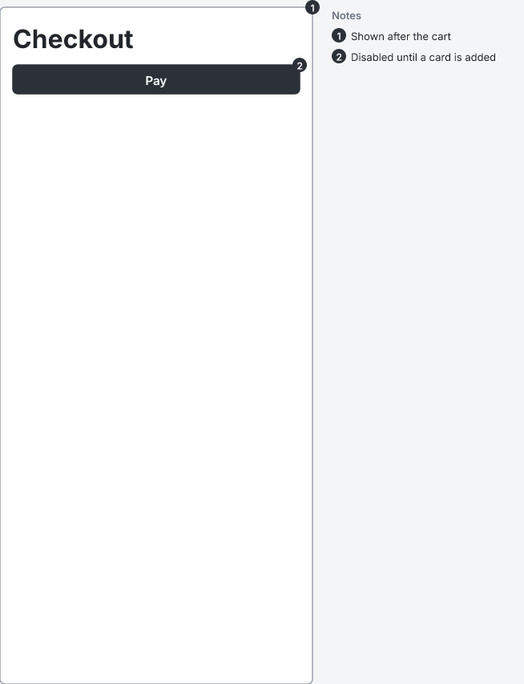

# RFC 0000: A note can point at its own screen

- **Status:** draft
- **Spec version:** 0.1, which is still a draft. This RFC relies on [RFC 0000-spec-releases](https://github.com/wirelith/wirelith/pull/20) (#20), under which a version is a draft until it is released.

## Summary

A note whose `for=` names its own screen is about the whole screen, exactly like a note without `for=`: its marker goes on the screen's top-right corner. And a screen drawn alone leaves room for that marker, so it isn't cut in half by the edge of the canvas.

## Motivation

Section 6 says `for=#id` points a note at "an element in the same screen", and that without `for` the note is about the whole screen. It doesn't say what happens when `for=` names the screen itself. Today such a note is accepted with no diagnostic and listed with a number, but no marker is drawn anywhere. The reader sees a numbered note that points at nothing.

It's an easy thing to write. Three existing conformance cases (`option-flows-off`, `option-id-prefix` and `option-no-source`) already do it, and their outputs have the missing marker built in.

A second problem shows up once the marker is drawn. A screen drawn alone (section 7.4) has no margin, so a marker centred on the frame's top-right corner is cut in half by the edge of the canvas. That already happens today to any note without `for=` on a screen drawn alone, for example in `component-notes`.

```wirelith
screen "Checkout" phone #checkout
  h1 "Checkout"
  button "Pay" primary #pay
  note "Shown after the cart" for=#checkout
  note "Disabled until a card is added" for=#pay
```

Today, note 1 has no marker:



With this change, note 1's marker is on the screen's corner, and shows in full:



Both pictures were drawn by the `wirelith` command.

## Design

**Section 6:**

> `for=#id` points the note at an element in the same screen. Without `for`, or with `for` naming the note's own screen, the note is about the whole screen.

This applies to variants too: a note in a variant with `for=` naming the variant is about the variant. Naming any other screen, including the variant's base, stays `E402`.

**Section 7.4, One screen alone,** adds:

> When the frame has a note marker on its own top-right corner, the frame starts 9 px down and the canvas reaches at least 9 px past the frame's right edge, so that the marker isn't cut off.

Nothing else changes: no new diagnostic, and the syntax tree keeps `for` as written.

## Learnability

It does what a writer means. Someone who gives every note a `for=`, including notes about the screen, gets the marker where they expect it. It adds no second way to write anything new, because both forms already parse today.

## Compatibility

Every valid source stays valid with the same meaning.

- **A note whose `for=` names its own screen** now draws a marker on the screen's corner.
- **A screen drawn alone with a note about the whole screen** gets 9 px of room above and to the right.

Four conformance outputs change: `component-notes`, `option-flows-off`, `option-id-prefix` and `option-no-source`.

## Security

None.

## Alternatives

- **Report a diagnostic.** For example, a warning saying "a note is already about its screen; drop `for=`". That makes writers delete something harmless that says exactly what they mean.
- **Move the frame marker inside the corner.** It would clear the canvas edge without growing it, but it would cover the screen's own content at its top-right, and it would sit in a different place from markers in an overview.

## Conformance

- **A new case, `component-note-for-screen`:** the source above.
- **Four outputs change,** as listed above.
- **New core tests:**
  - a note whose `for=` names its screen draws exactly what a note without `for=` draws;
  - every marker of a screen drawn alone is whole on the canvas.
