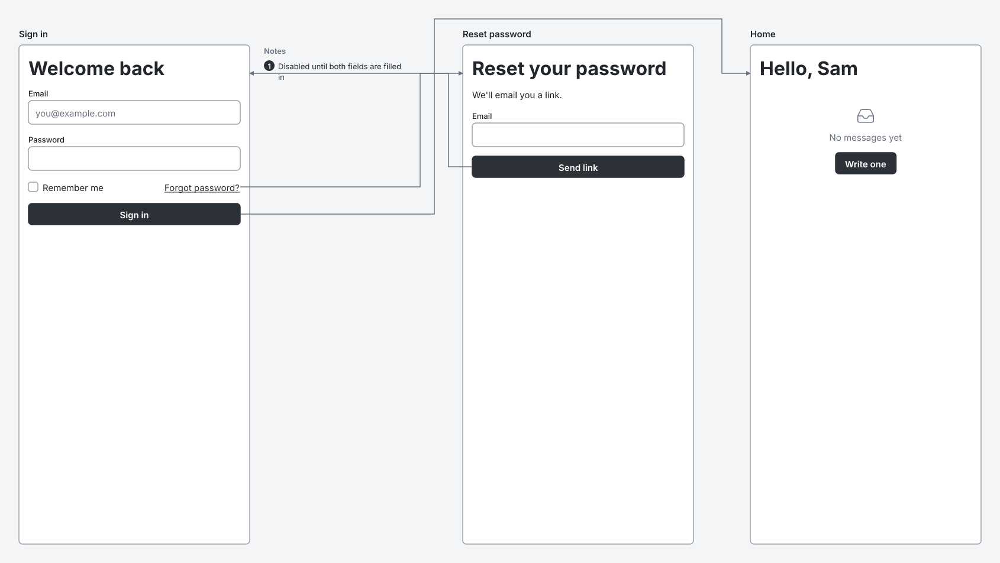
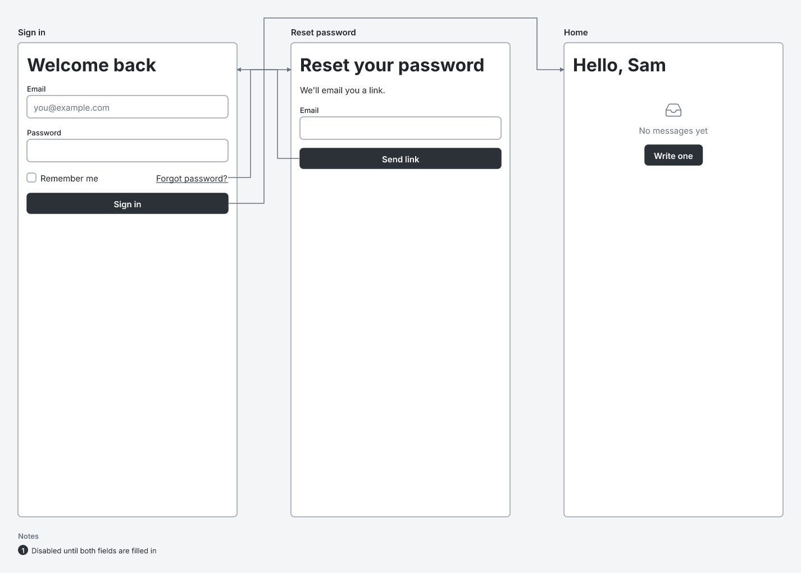

# RFC 0000: Notes below their screen

- **Status:** draft
- **Spec version:** 0.1. The specification is still a draft and no version has been released, so this changes 0.1 rather than starting 0.2.

## Summary

Draw a screen's notes list below the screen instead of beside it, so that no arrow can cross it. Sources don't change. Only where the list is drawn changes.

## Motivation

Today the notes list is a 240 px column 24 px to the right of its screen (spec section 7.4 and Appendix C). Arrows run through the gaps beside screens, so an arrow that leaves a screen with notes, or enters it from the right, crosses the notes column. The text becomes hard to read, and a label on the arrow can land on top of a note.

[This source](0000-notes-below-frames/example.wirelith) has one note on the "Sign in" screen, and three links that pass beside it:

```wirelith
wirelith 0.1

screen "Sign in" phone #signin
  h1 "Welcome back"
  input "Email" type=email placeholder="you@example.com"
  input "Password" type=password
  row justify=between
    checkbox "Remember me"
    link "Forgot password?" -> #reset
  button "Sign in" primary -> #home
  note "Disabled until both fields are filled in" for=#signin

screen "Reset password" phone #reset
  h1 "Reset your password"
  text "We'll email you a link."
  input "Email" type=email
  button "Send link" primary -> #signin

screen "Home" phone #home
  h1 "Hello, Sam"
  empty "No messages yet"
    button "Write one" primary
```

Today, three arrows run through the note:



With this change, the note is below the screen and the arrows pass it by:



Both pictures were drawn by the `wirelith` command from the source above.

## Design

Section 7.4, **Notes**, becomes:

> A frame with notes has its notes list 24 px below it, as wide as the frame or 240 px, whichever is wider. The list counts as part of the frame for spacing. It is below the frame, not beside it, so that no arrow crosses it: arrows run only beside frames and above bands.

Appendix C, **Notes list**, becomes:

> As wide as the frame or 240 px, whichever is wider, starting 24 px below the frame, level with its left edge. A heading `Notes` (13, weight 600, line height 18, `muted`), a 2u gap, then each note: its marker, and its text from 24 px further right (13, weight 400, line height 18, wrapping to the list's width less 24 px), with 2u between notes.

For spacing, a frame with notes takes up:

- **width:** the frame's width, or the list's width if that is wider (it is only wider for frames narrower than 240 px);
- **height:** the frame's height, plus 24 px, plus the list's height.

Wording elsewhere in the spec changes from "beside" to "below" (sections 6, 7.4 "One screen alone" and 12.3), with no change in meaning. Markers don't change: they stay on the target's top-right corner. Nothing else in layout or arrow routing changes.

Why no arrow can cross the list: an arrow's horizontal runs are level with its source or target frame, or in a lane above a band. Its vertical runs are in the gaps beside frames. The list is below its frame, within the frame's spacing width, so none of these reach it.

## Learnability

Nothing to learn. Sources are written exactly as before.

## Compatibility

Every valid source stays valid with the same meaning. Sources with notes render differently:

- the overview is taller, by the height of the tallest notes list in a row, plus 24 px;
- it is narrower, by up to 264 px per frame with notes.

A source close to the 16,000 px canvas height limit could now pass it and get `E701`; a source close to the width limit gets more room. Hosts that read the notes list's position from the SVG need to update. The list's id (`<frame's id>-notes`) doesn't change.

## Security

None. No new output elements or attributes, and no new limits.

## Alternatives

- **Notes on the left.** Arrows into a screen from the left would cross them instead.
- **Routing arrows around the notes column.** More complex, and the column would still push every arrow's gap further from the screen.
- **A notes list under the whole overview.** Notes would end up far from their screen, often off screen when a large overview is zoomed in.

## Conformance

The six cases whose output contains notes get new `output.svg` files:

- `component-notes`
- `example-18-3-settings-page`
- `example-ai-spec`
- `option-flows-off`
- `option-id-prefix`
- `option-no-source`

No trees or diagnostics change. Core gets two new tests:

- no arrow crosses a notes list, over 300 generated sources;
- the list's position and width, including a frame narrower than 240 px.

## Out of scope

Two other overlaps, found while writing this, need their own RFCs:

- **Arrows through wider variants.** An arrow to a variant can run through a wider frame above it in the same group.
- **Arrow labels in narrow gaps.** A label wider than the gap between two frames can overlap them.
